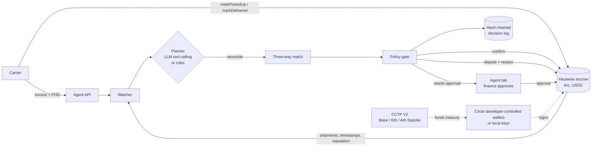

# Haulwise

USDC escrow for freight payments on [Arc](https://arc.io). A shipper locks the
freight rate in a contract, the carrier marks pickup and delivery, and the
money moves when delivery is confirmed, when the confirmation window lapses, or
when a dispute is decided.

Live app: [haulwise-arc.vercel.app](https://haulwise-arc.vercel.app) (Arc mainnet).
Settlement agent (Arc testnet, escrow 0x8975c51D4891C8aa44B6f4C6D377ca6081866E79): [status](https://haulwise-agent-production.up.railway.app/api/status) · [decision log](https://haulwise-agent-production.up.railway.app/api/decisions), shown in the app's Agent tab.

The escrow contract is named `CargoBill` (the project's working name). It was
deployed under that name and is left unchanged so the deployed bytecode keeps
matching the verified source.

## Why

Small carriers in road freight are typically paid 30 to 90 days after
delivery, or sell their invoices to a factoring company at a 3 to 6% discount.
Shippers, for their part, don't want to pay before the load moves. An escrow
with onchain deadlines gives both sides a neutral holder for the money and a
public record of how each carrier has performed.

Arc fits this because gas is paid in USDC (around a cent per transaction) and
blocks finalise in under a second, so per-shipment payments are cheap and the
payer only ever needs one asset.

## Deployment

| | |
|---|---|
| Network | Arc mainnet, chain id 5042 |
| Contract (`CargoBill`) | [`0xc63caf75a63b53Cf0d30f599766824223ecb653E`](https://explorer.arc.io/address/0xc63caf75a63b53Cf0d30f599766824223ecb653E) |
| Deploy tx | [`0x4ae3ef88…3c62c`](https://explorer.arc.io/tx/0x4ae3ef88b6a9fe0798ee185c047e524001334de4be0963b7c0812bf67813c62c) |
| USDC | `0x3600000000000000000000000000000000000000` (Arc's native USDC, ERC-20 interface, 6 decimals) |
| Arbiter / fee recipient | `0xdBBea784E3E7E6b3DdD174c86Ebb5db06F59C41b` |
| Source verification | Sourcify, exact match ([view](https://repo.sourcify.dev/5042/0xc63caf75a63b53Cf0d30f599766824223ecb653E)) |

An older build is on Arc Testnet (chain 5042002) at
`0x016e722f13bde933a31e2ee281e76a8419a14567`.

## How it works

```
             createShipment (USDC pulled into escrow)
                        │
                     Created ──── cancel (shipper, after pickup deadline) ──► Cancelled
                        │ markPickedUp (carrier, before pickup deadline)
                        ▼
                    PickedUp ──── refundUndelivered (shipper, delivery deadline + 7d) ──► Refunded
                        │ markDelivered (carrier)
                        ▼
                    Delivered ─── confirmDelivery (shipper) ─────────────┐
                        │      └─ autoRelease (anyone, delivered + 48h) ──┴─► Released
                        │
   openDispute (shipper or carrier, from PickedUp or Delivered)
                        ▼
                    Disputed ──── resolveDispute (arbiter, any split) ───┐
                               └─ escalateTimeout (anyone, +14d, 50/50) ─┴─► Resolved
```

- A 0.5% fee (`PROTOCOL_FEE_BPS = 50`) goes to the fee recipient on releases. Dispute payouts carry no fee.
- Reputation is stored per carrier: `completed`, `late` (delivered after the deadline, or refunded as undelivered) and `disputed` (lost a dispute, i.e. got less than 50%). Shippers who lose disputes are counted in `shipperDisputesLost`.
- The arbiter role moves with a two-step `transferArbiter` / `acceptArbiter`.

## The app

React + Vite + wagmi. Three views, picked in the header:

- **Shipper**: create a shipment (approve + create), confirm delivery, cancel, claim a refund, open a dispute.
- **Carrier**: assigned jobs, pickup/delivery actions, released earnings, own reputation.
- **Arbiter**: only shown when the connected wallet is `arbiter()`. Lists disputed shipments with the stated reason and a carrier-share slider that calls `resolveDispute`.

The side panel is a rule-based monitor that runs in the browser and flags
overdue pickups, open refund windows, disputes nearing the 14-day timeout and
shipments eligible for auto-release. It does not sign anything and is not an
LLM.

If the wallet is on another chain, the app shows a banner with a switch button.

## Running it

Requires [Bun](https://bun.sh) and [Foundry](https://getfoundry.sh).

```sh
bun install
forge install            # forge-std and OpenZeppelin into lib/, if not present
bun run dev              # app against Arc mainnet
VITE_CHAIN=arcTestnet bun run dev   # app against Arc Testnet
```

`VITE_CARGOBILL_ADDRESS` overrides the contract address for the selected network.

```sh
forge test               # contract tests
bun run typecheck
bun run build
```

Deploying a new instance (the key is entered interactively and not stored):

```sh
USDC=0x3600000000000000000000000000000000000000 FEE_RECIPIENT=<addr> ARBITER=<addr> \
  forge script contracts/script/DeployCargoBill.s.sol \
  --rpc-url https://rpc.mainnet.arc.io --broadcast --interactives 1
```

Compiler settings in `foundry.toml` (solc 0.8.28, via-IR, 200 runs, `paris`) are
the ones used for the mainnet deployment; changing them breaks verification.

## Settlement agent

`agent/` is a Node service that does a shipper's freight accounts-payable work on Haulwise. For every shipment the carrier marks delivered, it:

1. Reads the carrier's invoice and proof of delivery (PDF or text).
2. Runs a three-way match of escrow terms (the PO), invoice and POD: amount, payout wallet, PO reference, lane, POD signature and date against the on-chain pickup and delivery timestamps, duplicate invoice numbers, and carrier dispute history.
3. Applies the company's spending policy, which covers per-shipment and rolling 24h auto-confirm limits, limits for new carriers, late-delivery escalation and blocked carriers.
4. Takes one action: confirms delivery so escrow releases, opens a dispute with an evidence-based reason written on-chain, holds while a document is missing, or escalates to finance in the Agent tab.
5. Raises an approval before the carrier's 48h auto-release window closes if documents are still incomplete. On the receivables side, it calls `autoRelease` for carrier wallets it manages once the window has passed.

The model plans and writes the rationale. Policy lives in `agent/src/policy.ts` and runs before any transaction is signed, so a prompt can't move money past a limit. `confirm_delivery` is only accepted after `reconcile` has returned a `confirm` verdict.

Every decision is appended to `data/decisions.jsonl`. Each entry commits to the previous one with SHA-256, so an edited or deleted line shows up in `/api/status` (`ledger.ok`).



**Circle stack.** Each managed account is either a Circle developer-controlled wallet on `ARC-TESTNET`, with keys held in Circle's MPC and transactions sent through `createContractExecutionTransaction`, or a local key as a fallback. Circle's faucet API (`scripts/circle-faucet.ts`) funds the wallets. The treasury can be topped up from other testnets over CCTP V2 (`scripts/cctp-fund.ts`): burn on the source chain, get an Iris attestation, then `receiveMessage` on Arc. All settlement is in USDC on Arc, which also pays for gas.

**Planner.** Set `OPENAI_API_KEY`, `XAI_API_KEY`, `OPENROUTER_API_KEY`, `GROQ_API_KEY`, or `LLM_BASE_URL` + `LLM_API_KEY` + `LLM_MODEL` to use an LLM with tool calling. The model reads the raw documents, extracts the fields, calls `reconcile`, and picks an action. Without a key, a deterministic rules planner runs the same tools in a fixed order. Each log entry records which planner made the call.

### Running the agent

```bash
cd agent && npm install
npm run wallets:init                     # Circle wallets if CIRCLE_API_KEY + CIRCLE_ENTITY_SECRET are set, local keys otherwise
HAULWISE_ESCROW=0x... npm run traction -- --count 20   # fund, create, pick up, deliver, file documents, run the agent
HAULWISE_ESCROW=0x... AGENT_ADMIN_TOKEN=... npm start  # API on :8787, ticks every 30s
npm test                                 # policy, matching, extraction, ledger tests
```

Then build the front end with `VITE_AGENT_URL=http://localhost:8787 VITE_CHAIN=arcTestnet` and open the **Agent** tab.

API: `GET /api/status`, `GET /api/decisions`, `GET /api/approvals`, `POST /api/approvals/:id` (`{"decision":"approve"|"reject"}`), `PUT /api/policy`, `POST /api/documents/:shipmentId?kind=invoice|pod&filename=...` (raw body). Write endpoints need `Authorization: Bearer $AGENT_ADMIN_TOKEN`.

## Tests

`forge test` runs 81 tests in two suites: 80 unit tests for state transitions, deadline boundaries, fee splits,
reputation counters and access control, and one stateful invariant test (random sequences of create / pickup /
deliver / confirm / dispute / resolve / cancel / refund) asserting that the
contract's USDC balance always equals the sum of open escrows.

## Security notes and known limits

The contract has not been audited. Known trade-offs:

- **Single arbiter.** One address decides disputes. It is currently the deployer key; it should move to a multisig.
- **Disputes can stall payment.** Either party can open a dispute from `PickedUp` or `Delivered`. A shipper can use this to block auto-release; if the arbiter doesn't act, the 14-day timeout splits 50/50. A carrier can likewise dispute an undelivered load before the refund window opens and force the same split.
- **Push payments.** Payouts are direct transfers. If USDC blocks an address, actions paying that address revert and the funds stay in escrow until an arbiter split avoids it.
- **No fee on tiny amounts.** The fee rounds down to zero below 200 base units (0.0002 USDC).
- **Delivery is self-reported.** `markDelivered` is the carrier's claim; the shipper's recourse is a dispute within 48 hours.
- **Metadata is unvalidated.** `metadataURI` is free text up to 256 bytes. The app only renders it as a link when it starts with `https://`.

## Roadmap

- Settlement agent: an LLM-driven service that reads delivery evidence (POD photos, tracking events), decides whether to confirm, wait or dispute, and logs its reasoning, with spending limits enforced by a contract rather than the prompt.
- Circle Wallets for shippers and carriers who don't run their own wallet, and Paymaster so carriers never need a USDC balance for gas.
- Park escrow that is waiting for delivery in USYC and return the yield to the shipper.
- Arbiter multisig, and per-shipment arbiter selection.
- Reputation-based terms: shorter auto-release windows for carriers with clean records.

## Layout

```
contracts/CargoBill.sol              escrow contract (deployed)
contracts/script/DeployCargoBill.s.sol
contracts/test/CargoBill.t.sol       unit + invariant tests
src/                                 React app
scripts/fetch-abi.ts                 pull a verified ABI from an Arc explorer
broadcast/                           mainnet deployment record
agent/                               settlement agent (Node/TS): planner, policy, matching, ledger, API
agent/scripts/                       wallets, Circle faucet, CCTP funding, testnet traction runner
```

## License

MIT
