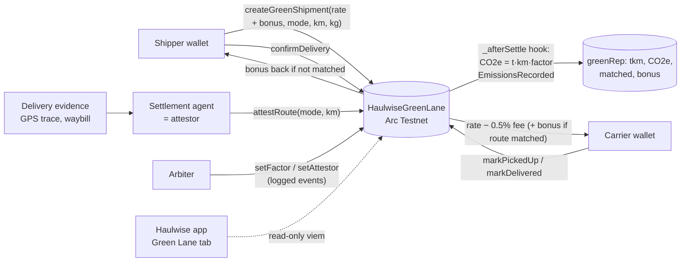

# Haulwise Green Lane

Green Lane adds an emissions layer to the Haulwise USDC freight escrow. It's built for the IEEE ClimateChain Global Hackathon 2026, Sustainable Supply Chains track.

- Contract: `HaulwiseGreenLane` ([contracts/HaulwiseGreenLane.sol](../contracts/HaulwiseGreenLane.sol)), which inherits the existing `CargoBill` escrow.
- Arc Testnet (chain 5042002): [`0xc84b618f6a2cc37c1c5daa60e9314d8dfcdf2569`](https://explorer.testnet.arc.io/address/0xc84b618f6a2cc37c1c5daa60e9314d8dfcdf2569), deploy tx [`0x37b6d83183…`](https://explorer.testnet.arc.io/tx/0x37b6d83183db381889a282ce7327e7144dde87d431703dc68739ca6a13e37121)
- App: **Green Lane** tab at https://haulwise-arc.vercel.app (a read-only view of the testnet contract)
- Tests: 16 Green Lane tests (including a fuzz test) + the 81 existing CargoBill tests, all passing (`forge test`)

## What it does
1. **CO2e on-chain at delivery confirmation.** `createGreenShipment` records the declared mode (Road/Rail/Sea/Air), distance and weight. When funds are released (`confirmDelivery` or `autoRelease`), the contract computes `CO2e (g) = weightKg × km × factor(mg/tkm) / 1e6` and stores it in `green[id].co2eGrams`. It also emits `EmissionsRecorded`. If an attested route exists, that route is used; otherwise the declared one is.
2. **Carrier green score.** Each carrier accumulates tonne-km, CO2e, attested shipments and matched routes. `intensityMgPerTkm(carrier)` gives weighted intensity. `greenScore(carrier)` (0-100) is the sum of two parts:
   - up to 50 points for intensity below the all-road (DEFRA HGV average) baseline
   - up to 50 points for the share of released shipments whose attested route matched the declaration
3. **USDC green bonus.** The shipper can lock an extra bonus. It goes to the carrier only if the route was attested, the attested mode equals the declared mode, and the attested distance is ≤ 110% of the declared distance. In every other case it returns to the shipper, including cancel, refund, dispute and timeout.

The route attestor is an address set by the arbiter, intended to be the Haulwise settlement agent. It reads delivery evidence (e.g. GPS trace, rail/sea waybill) and calls `attestRoute`. In the testnet demo, the deployer acts as arbiter and attestor.

## Architecture

Design choice: the base `CargoBill` got one empty `internal virtual _afterSettle(id, released)` hook, called once at every terminal state. Its own behaviour is unchanged (all 81 original tests pass). Green Lane overrides the hook, so the escrow logic is inherited rather than duplicated.

## Testnet demo (16 Oct 2026)
Two shipments with the same declaration (Rail, 1,000 km, 10 t, 0.10 USDC rate + 0.02 USDC bonus):

| # | Attested route | On-chain CO2e | Bonus | Txs |
|---|---|---|---|---|
| 1 | Rail, 1,050 km (within +10%) | 291.795 kg | paid to carrier | [create](https://explorer.testnet.arc.io/tx/0x77c0f8fe86319ee1499daef88f80e20fd4d9ed915d59abfb9e4f1a611b64bd5f) · [attest](https://explorer.testnet.arc.io/tx/0xbcc20e67df0bd86902af560d18318454bdfb7ee4aebac4f5329ba73ea7709652) · [confirm](https://explorer.testnet.arc.io/tx/0x4ff1cdf7377d8977ac8f546ebc2877980faf18af053e65db38cdc73abc96b2ac) |
| 2 | Road, 1,000 km (mode mismatch) | 1,016.3 kg | returned to shipper | [create](https://explorer.testnet.arc.io/tx/0x31dc4930b1e21cd49fdb055d4f9ade2edc8030ca5a57df1f914a4289f094f242) · [attest](https://explorer.testnet.arc.io/tx/0x13e7d8608d653e7658de2535ecc26ce9d1db96e56199a92cab60d342e037c0ad) · [confirm](https://explorer.testnet.arc.io/tx/0x77e346908d2dc31896121be6e79e276817484f438a3dc6d58a3457fa8b494751) |

Carrier `0x886661079b3AC616f35fd9484245B380a5C20E23` after both: intensity 63.8 g CO2e/tkm and greenScore 43/100 (18 from intensity + 25 from 1 of 2 matched routes).

These are demo transactions between our own test wallets. They are not real freight, and the numbers only show that the contract computes correctly.
